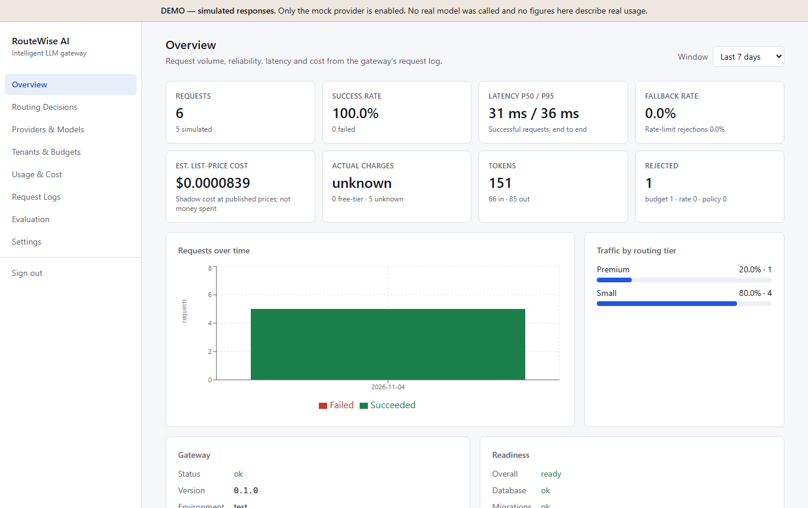
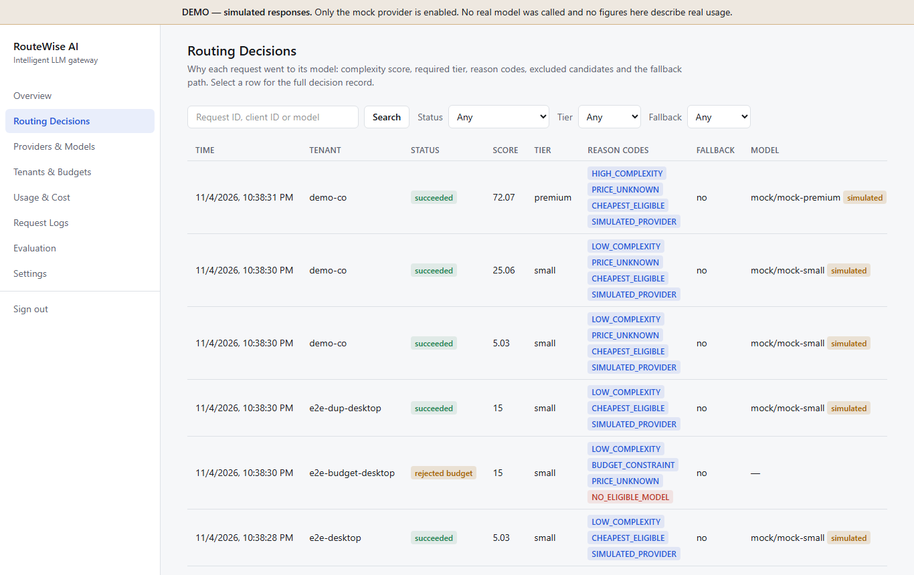
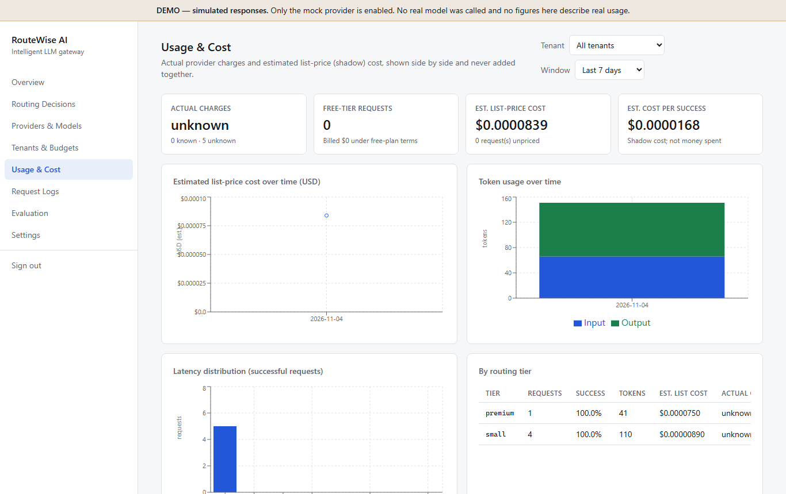
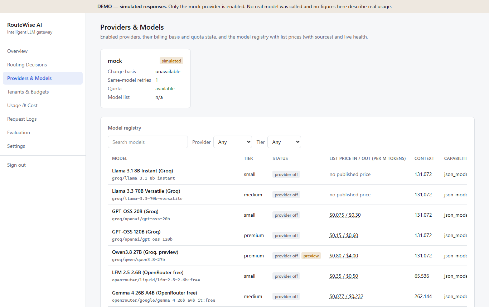
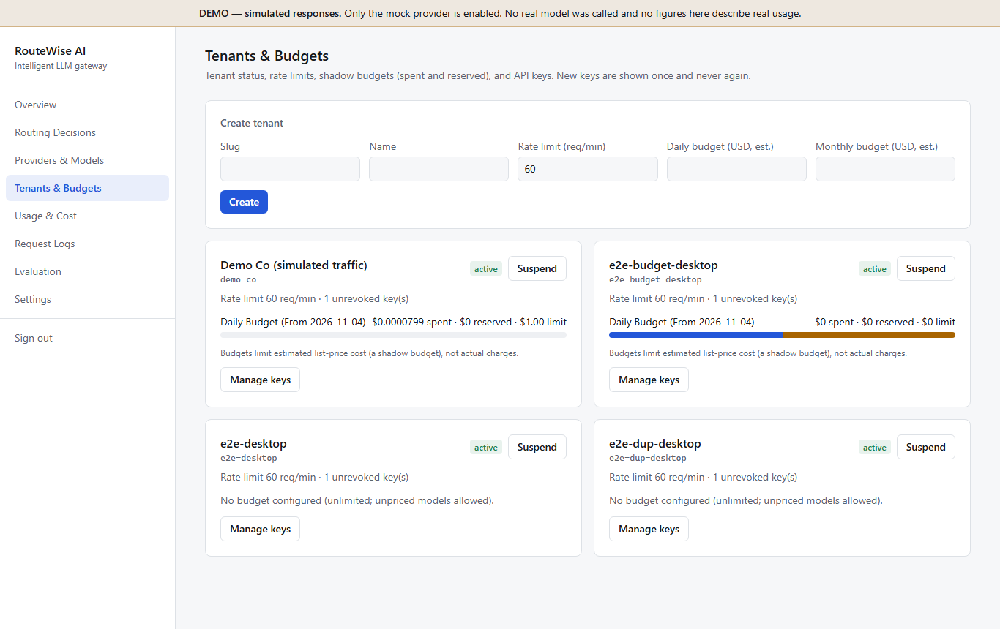
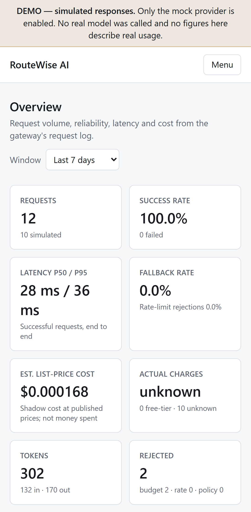

# RouteWise AI — Intelligent LLM Gateway

One API for many LLMs. Each request goes to the cheapest model that is capable enough for it, within per-tenant
budgets and latency targets. Every routing decision is explained and logged, and a pre-registered benchmark compares
routing against an always-premium baseline.

> **Status (2026-11-04).** Phases 1–6 are implemented and tested locally. Deployment (Phase 7) is prepared but not
> performed. **Groq is verified live with one successful request** (`openai/gpt-oss-20b`, free tier, persisted to
> Neon), but OpenRouter and Ollama aren't. Tests and screenshots use the clearly labelled mock provider. The benchmark
> framework works, but **no benchmark results exist yet**, so this README states no quality, cost or latency
> improvements. Details: [TASKS.md](TASKS.md).

## Problem

Hard-coding one model per feature wastes money on easy requests or quality on hard ones. Teams also can't see what each
tenant costs or why a request went where it did. RouteWise implements the spec card's idea, *cheap model by default,
premium only when the task needs it*, with the accounting and evidence to judge whether it works.

## Features

- **Unified API** `POST /api/v1/generate` with task type, quality, priority, latency target, max cost, idempotency key
- **Deterministic, explainable routing**: complexity score → required tier → 16 exclusion checks → ranking. Every
  response includes the policy version, reason codes, score breakdown, excluded models and fallback chain
- **Providers**: Groq, OpenRouter (free `:free` models only, a limited fallback), Ollama (local only), and a mock
- **Resilience**: timeouts, bounded retries with jittered backoff, Retry-After, circuit breakers, fallback chains, request deadline
- **No paid usage, enforced**: at startup, in routing, in the executor, and in the OpenRouter adapter
- **Multi-tenancy**: hashed API keys with create/list/revoke/rotate, isolation, per-tenant rate limits, daily/monthly
  shadow budgets with **atomic reservations** under concurrency
- **FinOps accounting**: actual charges (`reported` / `free_tier` / `estimated` / `unavailable`) kept separate from
  estimated list-price cost, with pricing snapshots (source and date). Unknown is never shown as $0
- **Benchmark**: 45 cases (v5, pending owner review; experiment manifest pins code, configuration, pacing and quota), deterministic scorers validated with reference and adversarial answers, pre-registered thresholds,
  Wilson and bootstrap CIs, interleaved strategies, full provenance
- **Dashboard**: 8 pages (overview, routing decisions, providers and models, tenants and budgets, usage and cost,
  request logs, evaluation, settings), responsive, admin sign-in via short-lived session tokens
- **Privacy**: prompts and responses are never stored or logged (hash and length only); secret redaction in logs

## Architecture

```
Client app ──Bearer rw_… key──▶ FastAPI gateway ──────────────────────────────▶ Groq · OpenRouter · Ollama · Mock
                                 auth → rate limit → budget read → route (pure)
                                 → idempotent log → atomic reservation
                                 → execute (retry/fallback/breaker, budget-capped)
                                 → settle + persist attempts            ──asyncpg/TLS──▶ Neon PostgreSQL
React dashboard ──admin session──▶ /api/v1/admin/*  (usage, requests, tenants, keys, config, evaluation)
Benchmark CLI ──same pipeline (in-process)──▶ evaluation_runs / evaluation_results + report files
```

Details: [docs/ARCHITECTURE.md](docs/ARCHITECTURE.md).

**Stack:** Python 3.12 · FastAPI · Pydantic · SQLAlchemy 2 (async) · Alembic · asyncpg · HTTPX · pytest ·
React 19 · TypeScript · Vite · Tailwind · Recharts · Vitest · Playwright · Neon PostgreSQL · GitHub Actions · Render (prepared).

## Routing in one paragraph

A task-type prior plus capped points for input length, output length, JSON, multi-step markers, constraint words,
reasoning verbs, math and code blocks gives a 0–100 score: below 35 is small, below 65 medium, otherwise premium. High-quality
requests and client preferences can raise the floor. Every model is checked against provider, paid status, tier,
capability, context, live health, budget and observed latency. The eligible list is ranked by worst-case list cost
(`cheapest_capable`) or tier first (`lowest_tier_first`), with OpenRouter ranked last to protect its 50/day allowance.
It's a transparent heuristic, not an optimal router. See [docs/ROUTING_METHODOLOGY.md](docs/ROUTING_METHODOLOGY.md),
including known limits.

## Benchmark

`baseline_premium` (every case on the premium tier) vs `routewise` vs `routewise_tier_first`, on 45 cases (15 simple,
18 standard, 12 complex), with thresholds registered before any run: non-inferior if within 5 percentage points, and
supported only by the bootstrap CI.

**Results: none yet.** The dataset is now v5 (see the [changelog](evaluation/datasets/routewise_bench_v5.CHANGELOG.md)),
and results are publishable only after you review it. Any result will apply only to this fixed suite and pinned
configuration, not to production workloads in general. With the current providers, the comparison is between two sizes of one family (GPT-OSS 20B vs 120B), not
independent model families. A mock pipeline check (135 requests, v1) ran end to end and was correctly marked
*simulated, not publishable*. See [docs/EVALUATION.md](docs/EVALUATION.md).

## Database

12 tables are shown in [docs/DATABASE_SCHEMA.md](docs/DATABASE_SCHEMA.md): tenants, api_keys, tenant_budgets,
rate_limit_windows, pricing_snapshots, provider_models, routing_policies, request_logs, request_attempts and
evaluation_*. Alembic head `0002` is applied to Neon.

## API example

```powershell
$h = @{ Authorization = "Bearer $env:ROUTEWISE_KEY" }   # tenant key from create-api-key; never commit it
Invoke-RestMethod http://127.0.0.1:8000/api/v1/generate -Method Post -Headers $h -ContentType application/json `
  -Body '{"prompt":"Classify the sentiment: I love this phone.","task_type":"classification","request_id":"demo-1"}'
```

Full reference: [docs/API.md](docs/API.md).

## Local setup (Windows PowerShell)

Requirements: Python 3.12, [uv](https://docs.astral.sh/uv/), Node 24.

```powershell
Copy-Item .env.example .env        # fill DATABASE_URL (Neon), ADMIN_TOKEN, API_KEY_PEPPER
.\scripts\dev.ps1 -Setup           # install, migrate, seed, start API (:8000) + dashboard (:5173)
cd backend
uv run python -m app.cli create-tenant my-app "My App" --daily 1.00
uv run python -m app.cli create-api-key my-app     # prints the key once
```

Sign in to the dashboard with your `ADMIN_TOKEN`. Without a `.env`, the backend uses local SQLite. With only the mock
provider enabled, the dashboard shows a **DEMO — simulated responses** banner.

### Environment variables

See [.env.example](.env.example) for the full list with comments. Key ones: `DATABASE_URL`, `ADMIN_TOKEN`,
`API_KEY_PEPPER`, `CORS_ORIGINS`, `MOCK_PROVIDER_ENABLED`, `GROQ_ENABLED`/`GROQ_API_KEY`/`GROQ_BILLING_PLAN`,
`OPENROUTER_ENABLED`/`OPENROUTER_API_KEY`, `OLLAMA_ENABLED`, `REQUEST_DEADLINE_S`, `CIRCUIT_*`, `RETRY_*`. The frontend
uses only `VITE_API_BASE_URL`, which is public and not a secret.

## Testing

```powershell
cd backend;  uv run ruff check .; uv run mypy app tests; uv run pytest -q
cd frontend; npm run lint; npm run typecheck; npm test; npm run build; npm run test:e2e
```

Latest local results: backend **382 passed** (86 skipped: PostgreSQL variants and opt-in live checks), frontend **28
passed**, Playwright **9 passed** (desktop and mobile), pip-audit and production `npm audit` clean, and secret scan clean
against a reviewed baseline. CI is defined but **has not run yet** (no push). See [docs/TESTING.md](docs/TESTING.md).

## Deployment

**Not deployed yet; there is no live URL.** Prepared: [`render.yaml`](render.yaml) (Render free web service and static
site), [`backend/Dockerfile`](backend/Dockerfile), and Neon. Production mode was verified locally against Neon. Steps and
blockers are in [docs/DEPLOYMENT.md](docs/DEPLOYMENT.md).

## Screenshots

Captured by Playwright from the running app with **simulated (mock-provider) demo data**. These are not real usage.

| | |
|---|---|
|  |  |
|  |  |
|  |  |

## Comparison with reference repositories

The spec card lists three reference repositories (production-llm-applications, awesome-llm-prod,
awesome-llm-token-optimization). This project was written from scratch; **no code was copied from them**. They have not
yet been reviewed in detail for this README, so no claims are made about what they contain. What this implementation
emphasises, which you should check against them before citing differences:

- a pre-registered, CI-gated benchmark with reference-validated scorers, not a demo comparison
- strict separation of actual charges from shadow list-price cost, with "unknown" never shown as $0
- atomic, concurrency-tested budget reservations, with execution capped by the reservation
- no-paid-usage guarantees enforced in four places
- per-decision explanations with every excluded candidate and its reasons

## Limitations

- **Live verification is minimal:** one successful Groq request (and one 404 against a retired model). OpenRouter and
  Ollama are untested live. Groq currently has no medium-tier model, so medium-tier requests use `gpt-oss-120b`.
- Keyword-based complexity scoring misses semantic difficulty and can be gamed. Tier labels are judgement calls.
- Provider health and the OpenRouter quota guard are in-memory per process (fine for one instance).
- Fixed-window rate limits allow 2× bursts across a minute boundary.
- An attempt with unknown usage (for example a timeout) is charged to the shadow budget at its worst
  case and makes the list cost `unavailable`. This is conservative, so it over-counts on purpose.
- 45 benchmark cases give wide CIs; "premium" means the best *free* model, not a frontier model.
- Non-streaming only. No response cache (by decision).
- Free hosting sleeps after 15 minutes idle (~1 minute wake).

## Documentation

[PRD](docs/PRD.md) · [TRD](docs/TRD.md) · [Architecture](docs/ARCHITECTURE.md) · [Routing](docs/ROUTING_METHODOLOGY.md) ·
[Providers](docs/PROVIDER_INTEGRATION.md) · [Cost accounting](docs/COST_ACCOUNTING.md) · [Evaluation](docs/EVALUATION.md) ·
[Tenancy and security](docs/TENANCY_AND_SECURITY.md) · [Database](docs/DATABASE_SCHEMA.md) · [API](docs/API.md) ·
[Testing](docs/TESTING.md) · [Deployment](docs/DEPLOYMENT.md) · [Runbook](docs/OPERATIONS_RUNBOOK.md) ·
[Traceability](docs/REQUIREMENTS_TRACEABILITY.md)
