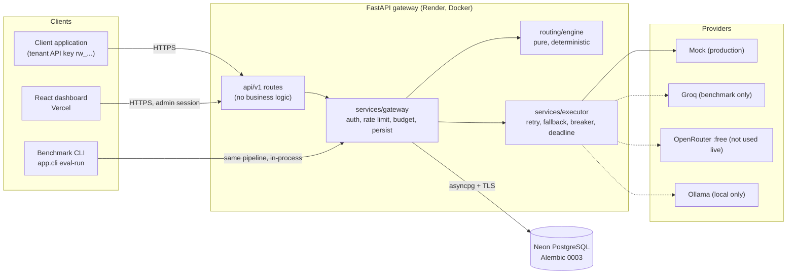
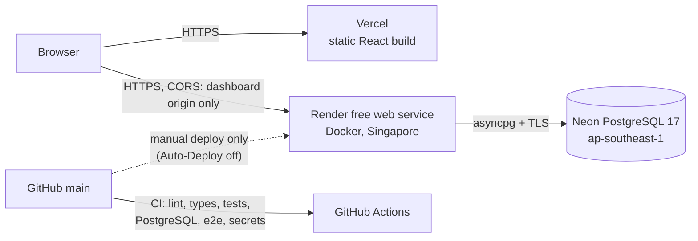
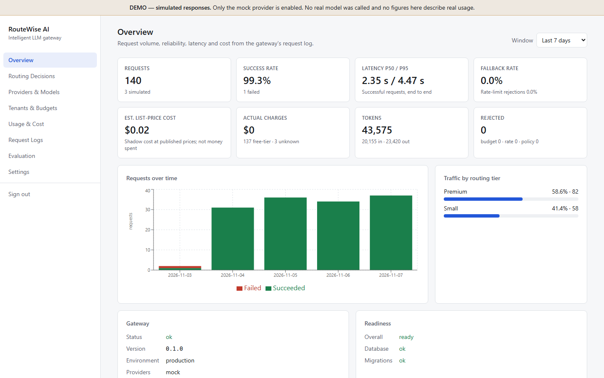
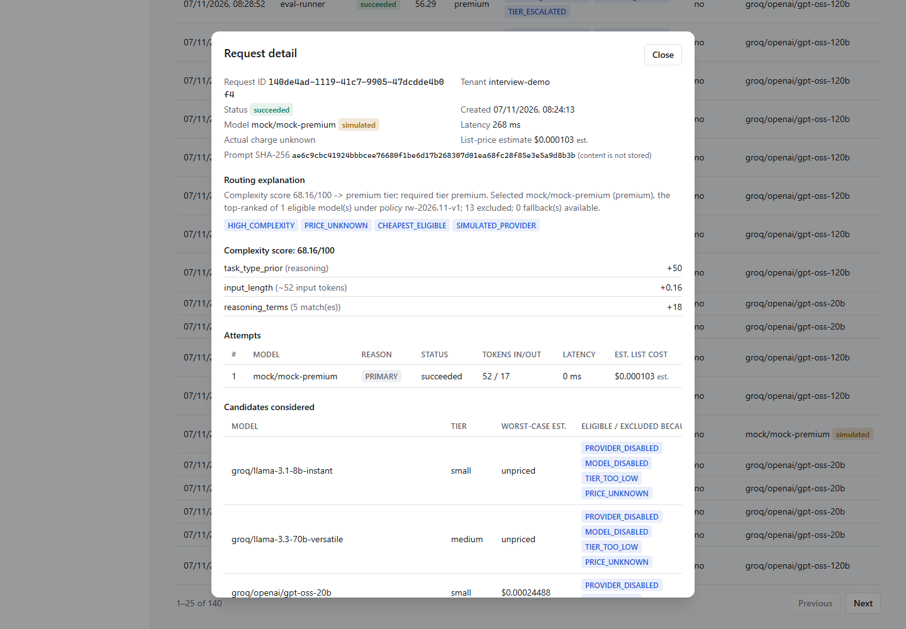
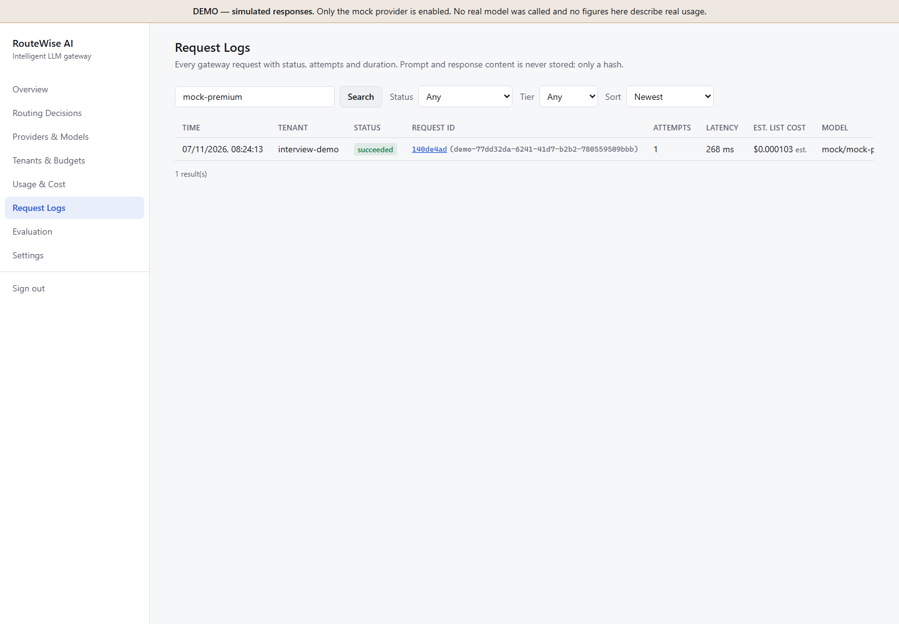
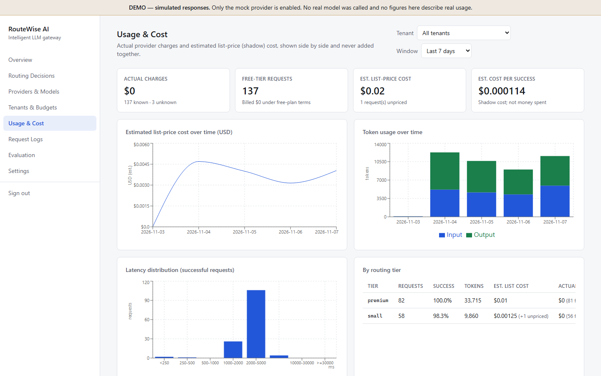
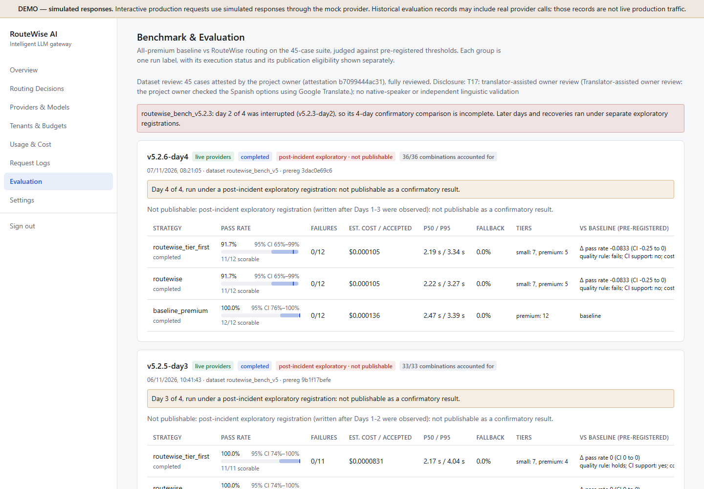
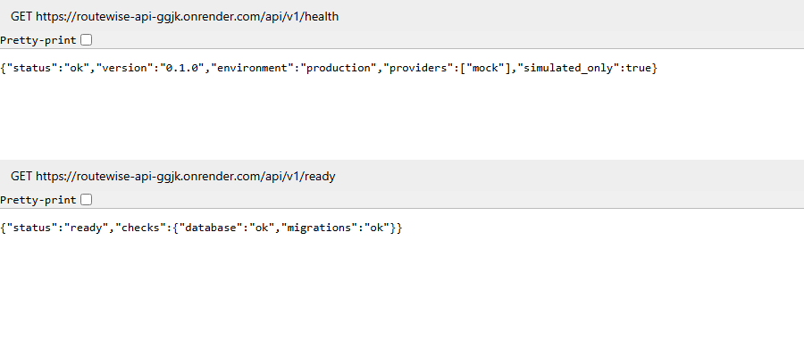
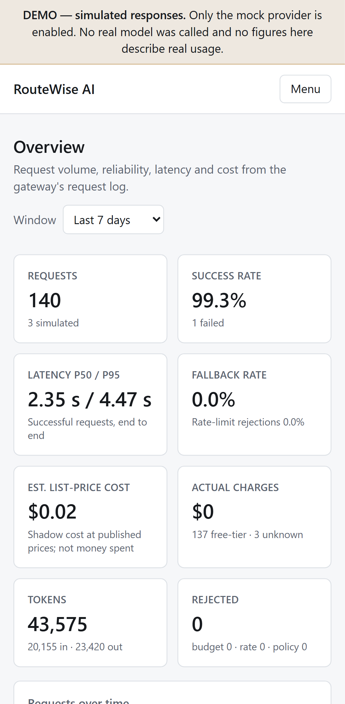

# RouteWise AI: an intelligent, cost-aware LLM gateway

RouteWise is one HTTP API in front of several LLM providers. For each request it scores how demanding the task
is, picks the cheapest model that is capable enough, enforces per-tenant rate limits and budgets, retries or
falls back when a provider fails, and records **why** every routing decision was made. A React dashboard shows
the traffic, costs and decisions. A pre-registered benchmark compares routing against an always-premium baseline.

| | |
|---|---|
| **Live dashboard** | https://routewise-dashboard.vercel.app (admin sign-in required, except *Providers & Models*) |
| **Live API** | https://routewise-api-ggjk.onrender.com: try [`/api/v1/health`](https://routewise-api-ggjk.onrender.com/api/v1/health) and [`/api/v1/ready`](https://routewise-api-ggjk.onrender.com/api/v1/ready) |
| **Status** | Deployed (Render + Vercel + Neon). CI runs on every push to `main` and on pull requests; for example, run [42330582354](https://github.com/parammeet83/intelligent-llm-gateway/actions/runs/42330582354) passed on the Day 4 registration commit `60a3740`. All four benchmark days run once under four registrations; the original four-day confirmatory experiment remains incomplete |

> [!IMPORTANT]
> **Production runs the mock provider only** (`MOCK_PROVIDER_ENABLED=true`, `GROQ_ENABLED=false`; `/health` reports
> `"simulated_only": true`). Every response from the live API is **simulated** and labelled as such, and the dashboard
> shows a *DEMO — simulated responses* banner. Real Groq calls happened only in the benchmark, which runs the same
> gateway pipeline from the command line (see [Benchmark](#benchmark-findings)). Production is kept off Groq so
> public traffic can't use the free quota the benchmark needs.

## Contents

- [The problem](#the-problem)
- [What is implemented](#what-is-implemented)
- [Architecture](#architecture)
- [Request lifecycle](#request-lifecycle)
- [Routing](#routing)
- [Data model](#data-model)
- [API overview](#api-overview)
- [Dashboard](#dashboard)
- [Security and reliability](#security-and-reliability)
- [Run it locally](#run-it-locally)
- [Tests](#tests)
- [Production deployment](#production-deployment)
- [Benchmark findings](#benchmark-findings)
- [Limitations and future work](#limitations-and-future-work)
- [Screenshots](#screenshots)
- [Documentation map](#documentation-map)

## The problem

Applications that hard-code one model per feature either overpay, sending easy requests to a large model, or
under-serve, sending hard requests to a small one. Teams also can't easily answer what each customer costs, why a
request went to a given model, or what happens when a provider is down or rate-limited.

A gateway puts those concerns in one place:
- **Routing:** cheap model by default, premium only when the task needs it.
- **Explanations:** every decision is recorded with its reasons.
- **Tenancy:** isolation and budgets per customer.
- **Resilience:** retries and fallbacks handled once, not in every application.
- **Evidence:** a benchmark that tests whether routing saves cost without losing quality.

## What is implemented

| Area | Implemented | Where |
|---|---|---|
| Unified API | `POST /api/v1/generate` with task type, quality, priority, preferred tier, latency target, max cost, JSON mode, provider and model constraints, and an idempotency key | [`api/v1/generate.py`](backend/app/api/v1/generate.py), [`schemas.py`](backend/app/api/v1/schemas.py) |
| Explainable routing | Pure, deterministic rules: features → 0–100 score → required tier → filter every model (each exclusion recorded with a reason code) → rank → selected model plus fallback chain | [`backend/app/routing/`](backend/app/routing/), [`routing_policy.yaml`](backend/config/routing_policy.yaml) |
| Providers | One `Provider` interface. Adapters: **Groq** (used live in the benchmark), **OpenRouter** (`:free` models only; fallback-only), **Ollama** (local only), **Mock** (deterministic, always `simulated`) | [`backend/app/providers/`](backend/app/providers/) |
| Resilience | Per-call timeout, bounded retries with jittered backoff, `Retry-After`, circuit breakers, provider lockout, fallback chain, overall request deadline | [`services/executor.py`](backend/app/services/executor.py), [`resilience/health.py`](backend/app/resilience/health.py) |
| Multi-tenancy | Tenants; API keys stored only as HMAC-SHA256 hashes (create, list, revoke, rotate with grace); cross-tenant isolation; per-tenant rate limits | [`auth/`](backend/app/auth/), [`tenancy/`](backend/app/tenancy/) |
| Budgets and cost | Daily and monthly **shadow budgets** with atomic reservations (concurrency-tested on PostgreSQL). Actual charges kept separate from estimated list-price cost. Unknown cost is never shown as $0 | [`accounting/`](backend/app/accounting/), [docs/COST_ACCOUNTING.md](docs/COST_ACCOUNTING.md) |
| No paid usage | Paid models refused at startup, in routing, in the executor and in the OpenRouter adapter; `ALLOW_PAID_MODELS=true` is rejected | [`core/config.py`](backend/app/core/config.py) |
| Privacy | Prompts and responses are not stored or logged (only a SHA-256 hash and length); credential-shaped values are redacted from logs | [`core/logging.py`](backend/app/core/logging.py) |
| Dashboard | 8 pages: Overview, Routing Decisions, Providers & Models, Tenants & Budgets, Usage & Cost, Request Logs, Evaluation, Settings. Admin sign-in via short-lived session tokens | [`frontend/src/`](frontend/src/) |
| Benchmark | 45-case dataset; deterministic scorers; pre-registered thresholds; hash-pinned code and configuration; Wilson and bootstrap CIs; quota-aware pacing; fail-closed run-once protection | [`backend/app/evaluation/`](backend/app/evaluation/), [`evaluation/`](evaluation/) |

**Not implemented (deliberately or not yet):**
- streaming responses
- a response cache (evaluated and rejected; `tenants.cache_enabled` exists but is unused)
- a learned or LLM-based router
- multi-instance shared health state
- live OpenRouter or Ollama verification

## Architecture



The benchmark CLI doesn't call the deployed API. It builds the **same** gateway pipeline in-process
(`services/factory.build_gateway`), with Groq enabled for that process only, and writes to the same Neon database.
More detail: [docs/PROJECT_OVERVIEW.md](docs/PROJECT_OVERVIEW.md) and [docs/ARCHITECTURE.md](docs/ARCHITECTURE.md).

**Stack:**
- Backend: Python 3.12, FastAPI, Pydantic v2, SQLAlchemy 2 (async), Alembic, asyncpg, HTTPX, uv, pytest, ruff, mypy (strict)
- Frontend: React 19, TypeScript, Vite, Tailwind CSS, Recharts, Vitest, Playwright
- Platform: Neon PostgreSQL 17, Render (Docker), Vercel, GitHub Actions

## Request lifecycle

1. **Authenticate.** The `Bearer rw_…` key is HMAC-hashed and looked up. The tenant always comes from the key,
   never from the request body (unknown body fields are rejected).
2. **Rate limit.** An atomic per-tenant fixed-window counter (`rate_limit_windows`); over the limit → `429`.
3. **Idempotency.** `(tenant, request_id)` is unique; a repeated `request_id` → `409`.
4. **Route.** Pure function, no I/O: score the prompt, pick the required tier, filter and rank every model.
   Nothing eligible → `422 NO_ELIGIBLE_MODEL` with every exclusion listed.
5. **Reserve budget.** Atomically reserve the chosen model's worst-case list cost against the tenant's daily and
   monthly budgets. Can't cover it → `402 BUDGET_EXHAUSTED`.
6. **Execute.** Call the provider with a timeout. Transient errors get a bounded retry with jittered backoff;
   rate limits, auth errors and missing models move to the next model in the fallback chain. Circuit breakers skip
   unhealthy models; an overall deadline caps the request.
7. **Settle.** Record actual charge and estimated list cost separately, move the reservation to spent, and
   release the rest.
8. **Persist and respond.** One `request_logs` row (with the full decision record) plus one `request_attempts`
   row per provider call. The response includes the content, model, cost, latency and the `routing` explanation.

## Routing

Routing policy `rw-2026.11-v1` ([`routing_policy.yaml`](backend/config/routing_policy.yaml); full method in
[docs/ROUTING_METHODOLOGY.md](docs/ROUTING_METHODOLOGY.md)):

- **Score.** A task-type prior (classification 5 … reasoning 50), plus capped points for input length, long
  output, JSON output, multi-step markers, constraint words, reasoning verbs, math terms and code blocks; 0–100.
- **Tier.** Score < 35 → `small`, < 65 → `medium`, otherwise `premium`.
  - `quality=high` forces premium.
  - `preferred_tier` can raise the floor; it lowers it only with `allow_downgrade=true`.
- **Filter.** Every model is checked, and *all* its exclusion reasons are recorded: provider disabled, paid,
  tier too low, missing JSON capability, context or output too small, circuit open, quota exhausted, budget,
  unknown price under a budget, observed latency, and more.
- **Rank.** Two selection policies:
  - `cheapest_capable` (the `routewise` benchmark strategy) orders eligible models by worst-case list cost, so
    tier is only a floor.
  - `lowest_tier_first` (`routewise_tier_first`) prefers the required tier, then cost.
  - OpenRouter ranks last in both, to protect its 50-requests/day free allowance.
- **Explain.** Every response carries `routing`: policy version, score contributions, computed and required
  tier, reason codes (e.g. `LOW_COMPLEXITY`, `CHEAPEST_ELIGIBLE`, `TIER_ESCALATED`), excluded models with reasons,
  and the fallback chain.

This is a transparent heuristic, not an optimal or learned router. It misses semantic difficulty and can be gamed
with keywords.

**Current catalog** ([`models.yaml`](backend/config/models.yaml)):
- Groq has `openai/gpt-oss-20b` (small) and `openai/gpt-oss-120b` (premium), and no medium model, so medium
  requests escalate to 120B.
- The mock provider has `mock-small`, `mock-medium` and `mock-premium`.
- Five OpenRouter `:free` models are configured as fallbacks.
- Ollama `qwen2.5:1.5b` is local only.

## Data model

13 tables, managed by Alembic (head **`0003`** on Neon). Columns:
[docs/DATABASE_SCHEMA.md](docs/DATABASE_SCHEMA.md).

| Group | Tables |
|---|---|
| Tenancy | `tenants`, `api_keys` (hash and prefix only), `tenant_budgets` (limit, spent, reserved per period), `rate_limit_windows` |
| Catalog and policy | `provider_models`, `pricing_snapshots` (append-only list prices with source and date), `routing_policies` (versioned) |
| Traffic | `request_logs` (one per request: status, decision JSON, tokens, cost, prompt hash), `request_attempts` (one per provider call) |
| Benchmark | `evaluation_cases`, `evaluation_runs`, `evaluation_results`, `benchmark_execution_claims` (one row per revision and scheduled day; unique constraint) |

## API overview

Base path `/api/v1`. Full reference with errors and examples: [docs/API.md](docs/API.md).

| Access | Endpoints |
|---|---|
| Public | `GET /health`, `GET /ready`, `GET /models`, `GET /providers` |
| Tenant key | `POST /generate`, `GET /me`, `GET /me/usage`, `GET /me/requests`, `GET /me/requests/{id}` |
| Admin | `POST /admin/session`; `GET/POST /admin/tenants`, `PATCH /admin/tenants/{slug}`; `GET/POST /admin/tenants/{slug}/keys`, `POST /admin/keys/{id}/revoke`, `POST /admin/keys/{id}/rotate`; `GET /admin/usage`, `GET /admin/requests[/{id}]`, `GET /admin/config`, `GET /admin/evaluation/runs[/{id}]` |

```powershell
# Local example. The key comes from `app.cli create-api-key`; never commit it.
$h = @{ Authorization = "Bearer $env:ROUTEWISE_KEY" }
$body = @{ prompt = "Classify the sentiment: I love this phone."; task_type = "classification"
           request_id = "demo-$([guid]::NewGuid())" } | ConvertTo-Json      # unique per request; a repeat returns 409
Invoke-RestMethod http://127.0.0.1:8000/api/v1/generate -Method Post -Headers $h -ContentType application/json -Body $body
```

## Dashboard

React single-page app ([`frontend/`](frontend/)), deployed on Vercel. The only frontend variable is
`VITE_API_BASE_URL`, which is public.

| Page | Shows |
|---|---|
| Overview | KPIs (requests, success rate, p50/p95 latency, fallback rate, estimated list-price cost, actual charges, tokens, rejected), traffic by tier, gateway status |
| Routing Decisions | Each request's score, required tier, chosen model, reason codes and exclusions |
| Providers & Models | Registry, tiers, capabilities, list prices with sources, live health (no sign-in needed) |
| Tenants & Budgets | Create tenants, set budgets, issue, revoke and rotate keys (plaintext shown once) |
| Usage & Cost | Requests, tokens, list-price cost and latency over time, by provider, model, tier and tenant |
| Request Logs | Searchable, filterable log with per-request decision and attempt detail |
| Evaluation | Benchmark runs grouped by label, with pass rates, CIs, cost per accepted answer and verdicts |
| Settings | Routing policy and non-secret runtime settings, readiness |

## Security and reliability

- **Tenancy.** Tenant identity comes only from the API key, which is stored as an HMAC-SHA256 hash with a server
  pepper. Cross-tenant access returns 404. Keys can be revoked or rotated with a grace period.
- **Admin.** `ADMIN_TOKEN` is exchanged for a short-lived session token (login throttled to 5 attempts/min). The
  dashboard never stores the admin token itself.
- **Production config.** Weak or default secrets and SQLite are refused at startup in production; `/docs` is
  hidden; CORS allows only the dashboard origin.
- **Secrets.** Nothing in code or frontend variables; `.env` is git-ignored. CI runs `detect-secrets` against a
  reviewed baseline.
- **Reliability.** Provider timeouts, retries, circuit breakers, fallbacks and a request deadline.
  - Budget reservations are atomic. If a request crashes mid-flight, `app.cli reconcile` later settles its
    reservation, conservatively charging it in full.
  - Benchmark database writes are retried with backoff and are idempotent.
  - A scheduled benchmark day takes an **atomic database claim** (unique per revision and day) before any provider
    call, so it can never start twice.

Details: [docs/TENANCY_AND_SECURITY.md](docs/TENANCY_AND_SECURITY.md) and
[docs/PROJECT_OVERVIEW.md](docs/PROJECT_OVERVIEW.md#error-handling-and-reliability).

## Run it locally

Requirements: Windows PowerShell, Python 3.12, [uv](https://docs.astral.sh/uv/), Node 24.

```powershell
git clone https://github.com/parammeet83/intelligent-llm-gateway.git
cd intelligent-llm-gateway
Copy-Item .env.example .env      # then edit .env (see below)
.\scripts\dev.ps1 -Setup         # installs dependencies, migrates, seeds, starts API :8000 and dashboard :5173
```

In `.env`:
- Set `ADMIN_TOKEN` to a long random value, e.g. from
  `python -c "import secrets; print(secrets.token_urlsafe(48))"`. Admin endpoints and dashboard sign-in stay
  disabled until it is set.
- Either fill in `DATABASE_URL` or delete that line to use the local SQLite default. The template's placeholder URL
  won't connect.
- Leave `MOCK_PROVIDER_ENABLED=true` and `GROQ_ENABLED=false` for a fully offline, simulated setup.

Then, in a second PowerShell window:

```powershell
cd backend
uv run python -m app.cli create-tenant my-app "My App" --daily 1.00
uv run python -m app.cli create-api-key my-app          # prints the key once; keep it out of Git
```

Open http://localhost:5173 and sign in with your `ADMIN_TOKEN`.

**Environment** ([`.env.example`](.env.example) documents every variable; use placeholders, never real values in
docs):

| Variable | Purpose |
|---|---|
| `DATABASE_URL` | PostgreSQL URL (e.g. `postgresql://<user>:<password>@<endpoint>.neon.tech/<db>?sslmode=require`); defaults to local SQLite |
| `ADMIN_TOKEN`, `API_KEY_PEPPER` | Admin sign-in secret and API-key hashing pepper (long random values; required in production) |
| `CORS_ORIGINS` | Allowed dashboard origin(s) |
| `MOCK_PROVIDER_ENABLED` | `true` for the simulated provider |
| `GROQ_ENABLED`, `GROQ_API_KEY`, `GROQ_BILLING_PLAN` | Real Groq calls (free plan) |
| `OPENROUTER_ENABLED`, `OPENROUTER_API_KEY`, `OLLAMA_ENABLED`, `OLLAMA_BASE_URL` | Optional providers |
| `REQUEST_DEADLINE_S`, `PROVIDER_TIMEOUT_S`, `RETRY_BACKOFF_*`, `CIRCUIT_*` | Reliability tuning (defaults: 60 s, 30 s, 0.5–4 s, 3 failures / 30 s) |
| `ALLOW_PAID_MODELS` | Must stay `false`; `true` is refused |

To run the backend or dashboard on their own:

```powershell
cd backend;  uv run alembic upgrade head; uv run uvicorn app.main:create_app --factory --reload --port 8000
cd frontend; npm ci; npm run dev
```

## Tests

```powershell
cd backend
uv run ruff check .; uv run ruff format --check .; uv run mypy app tests
uv run pytest -q          # SQLite; set TEST_DATABASE_URL to a DISPOSABLE PostgreSQL to add the PostgreSQL variants
cd ..\frontend
npm run lint; npm run typecheck; npm test; npm run build
npm run test:e2e          # Playwright: starts its own throwaway backend (SQLite, mock provider)
```

CI run [42332875657](https://github.com/parammeet83/intelligent-llm-gateway/actions/runs/42332875657) on commit `89d708c` (Day 4 closure; GitHub Actions, PostgreSQL 17 service):

| Suite | Result |
|---|---|
| Backend tests | 1,716 passed, 10 skipped (opt-in live-database checks), 27 expected failures |
| Frontend Vitest | 29 passed |
| Playwright | 9 passed (desktop and mobile) |
| Dependency audits | `pip-audit` clean; production `npm audit` 0 vulnerabilities |
| Secret scan | clean |

No automated test calls a real provider. The 27 expected failures are strict `xfail` markers: older benchmark
revisions' "manifest still matches the code" tests, which *must* fail now that the code has moved on (see
[`tests/evaluation/conftest.py`](backend/tests/evaluation/conftest.py)). See [docs/TESTING.md](docs/TESTING.md).

## Production deployment



- The container runs `alembic upgrade head` and starts uvicorn only if the migration succeeds.
- Render's health check is `/api/v1/health`; `/api/v1/ready` checks the database and that its Alembic version
  matches the code.
- Render **Auto-Deploy is off**: commits are deployed manually after CI passes. The live deploy is commit `2456814`
  (migration `0003`).
- The free Render instance sleeps after 15 idle minutes; the first request then takes about a minute.
- Migration `0003` changed the rollback rules: never deploy a commit without it. The safe rollback target is
  `4193a94` (branch `rollback/v5.2.4-plus-0003`). See [docs/DEPLOYMENT.md](docs/DEPLOYMENT.md).

## Benchmark findings

Full write-up: [docs/BENCHMARK_RESULTS.md](docs/BENCHMARK_RESULTS.md).

**Setup.**
- Strategies:
  - `baseline_premium`: every request on the premium tier
  - `routewise`: `cheapest_capable`
  - `routewise_tier_first`: `lowest_tier_first`
- Dataset: 45 cases, 15 simple, 18 standard, 12 complex.
- Models: real Groq free-tier `gpt-oss-20b` and `gpt-oss-120b`.
- Plan: a four-day schedule of 10–12 cases per day (10, 12, 11 and 12 cases), registered before Day 1 (v5.2.3).

| Day | Revision | Combinations | Pass rate (baseline / routewise / tier-first) | Status |
|---|---|---|---|---|
| 1 (2026-11-04) | v5.2.3 | 30/30 | 10/10 · 9/10 · 9/10 | Completed. Both RouteWise strategies failed case T03 on the small model; the registered quality and cost rules **did not hold** that day |
| 2 (2026-11-05) | v5.2.3 | 11/36 | — | **Interrupted** by a Neon timeout. It remains an incident record; its runs stay `failed` |
| 2 (recovery) | v5.2.4 | 36/36 | 12/12 · 12/12 · 12/12 | A **separate**, disclosed post-hoc registration later accounted for all 36 Day 2 combinations: 11 genuine results carried over plus 25 run once. **Exploratory, non-publishable** |
| 3 (2026-11-06) | v5.2.5 | 33/33 | 11/11 · 11/11 · 11/11 | Completed; 25/25 independent reconciliation checks; **post-incident exploratory, non-publishable** |
| 4 (2026-11-07) | v5.2.6 | 36/36 | 12/12 · 11/12 · 11/12 | Completed; 27/27 independent reconciliation checks. Both RouteWise strategies failed case T04 on the small model, so the registered quality and cost rules **did not hold**. **Post-incident exploratory, non-publishable** |

**What this does and doesn't show.**
- **No confirmatory result.** The original four-day confirmatory experiment is **incomplete**: its Day 2 was
  interrupted, and the Day 2 recovery, Day 3 and Day 4 registrations were written after earlier days had been
  observed. No claim of statistical superiority or non-inferiority is made.
- **Descriptive totals (Days 1–4, not a registered analysis):** baseline 45/45, both RouteWise strategies 43/45.
  Both losses (T03, T04) were standard cases sent to the small model.
- **Cost ratios are exploratory.** RouteWise sent 50–70% of each day's requests to the smaller model. Estimated list-price cost
  per accepted answer was 0.86–0.92 × the baseline's on Day 1, 0.71–0.73 × on Day 3 and 0.77 × on Day 4. These are
  shadow list prices; actual charges were **$0** (free tier).
- **The two RouteWise strategies can't be told apart.** With only two Groq models enabled, they chose the same model
  on every case.
- **Small samples:** 10–12 cases per day give wide confidence intervals (e.g. [74.1%, 100%] for 11/11).

## Limitations and future work

**Limitations:**
- **Production is a demo:** mock provider only, so live responses are simulated.
- **Benchmark coverage:** only Groq was exercised with real calls (in the benchmark). OpenRouter and Ollama
  adapters are tested with fake transports only.
- **Routing heuristic:** keyword-based complexity scoring misses semantic difficulty, and tier labels are
  judgement calls.
- **Single-instance state:** provider health, circuit breakers and the OpenRouter quota counter live in memory per
  process.
- **Rate limiting:** fixed windows allow up to 2× bursts across a minute boundary.
- **Non-streaming only.**
- **Dashboard history mixes real and simulated records:** the live API only serves mock responses, but the
  benchmark's real Groq requests (from the CLI) are stored in the same database. The DEMO banner and the
  Evaluation page now say so (fixed 2026-11-07; see [docs/KNOWN_ISSUES.md](docs/KNOWN_ISSUES.md)).

**Future work:**
- shared health state (e.g. Redis) for multiple instances
- streaming
- semantic or learned complexity estimation, validated against the benchmark
- a fresh, fully prospective multi-day registration with more cases and more distinct model families

## Screenshots

Genuine screenshots of the **deployed** app, captured with Playwright (real Chromium) on 2026-11-07 and stored in
[`docs/screenshots/production/`](docs/screenshots/production/):
- The live API is mock-only, so the one interactive request shown (tenant `interview-demo`) is **simulated**.
- The `eval-runner` rows and token totals come from the real Groq benchmark, which ran from the CLI against the same
  database.
- The Evaluation page shows each benchmark group's execution status and publication eligibility separately.

| | |
|---|---|
|  |  |
|  |  |
|  |  |
|  | |

Older images in [`docs/screenshots/`](docs/screenshots/) are from a local mock run on 2026-11-04. The checklist is in
[docs/PORTFOLIO_ASSET_CHECKLIST.md](docs/PORTFOLIO_ASSET_CHECKLIST.md).

## Documentation map

| For | Read |
|---|---|
| A guided tour of the design | [Project overview](docs/PROJECT_OVERVIEW.md) |
| Presenting it | [Demo guide](docs/DEMO_GUIDE.md) · [Interview preparation](docs/INTERVIEW_PREPARATION.md) · [Portfolio checklist](docs/PORTFOLIO_ASSET_CHECKLIST.md) |
| Results | [Benchmark results](docs/BENCHMARK_RESULTS.md) · [Day 3 closure](docs/BENCHMARK_DAY3_CLOSURE_v5.2.5.md) · [Day 4 closure](docs/BENCHMARK_DAY4_CLOSURE_v5.2.6.md) · [Evaluation method](docs/EVALUATION.md) |
| Internals | [Architecture](docs/ARCHITECTURE.md) · [Routing](docs/ROUTING_METHODOLOGY.md) · [Providers](docs/PROVIDER_INTEGRATION.md) · [Cost accounting](docs/COST_ACCOUNTING.md) · [Tenancy and security](docs/TENANCY_AND_SECURITY.md) · [Database](docs/DATABASE_SCHEMA.md) · [API](docs/API.md) |
| Operations | [Deployment](docs/DEPLOYMENT.md) · [Operations runbook](docs/OPERATIONS_RUNBOOK.md) · [Benchmark operator runbook](docs/BENCHMARK_OPERATOR_RUNBOOK.md) · [Testing](docs/TESTING.md) · [Known issues](docs/KNOWN_ISSUES.md) |
| Requirements | [PRD](docs/PRD.md) · [TRD](docs/TRD.md) · [Traceability](docs/REQUIREMENTS_TRACEABILITY.md) |
