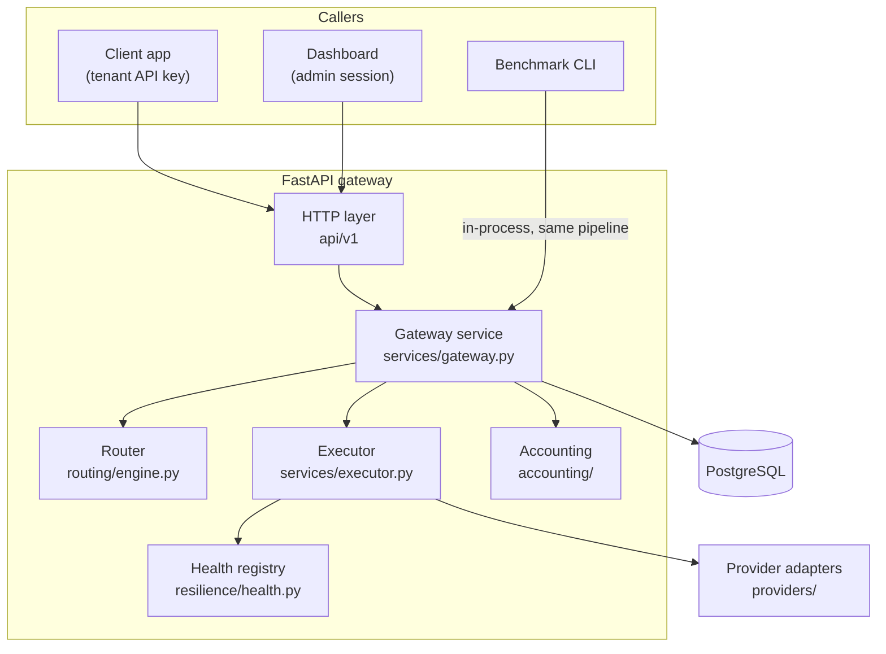
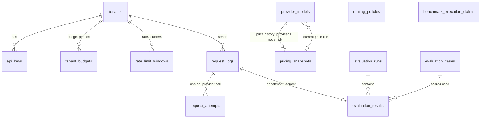
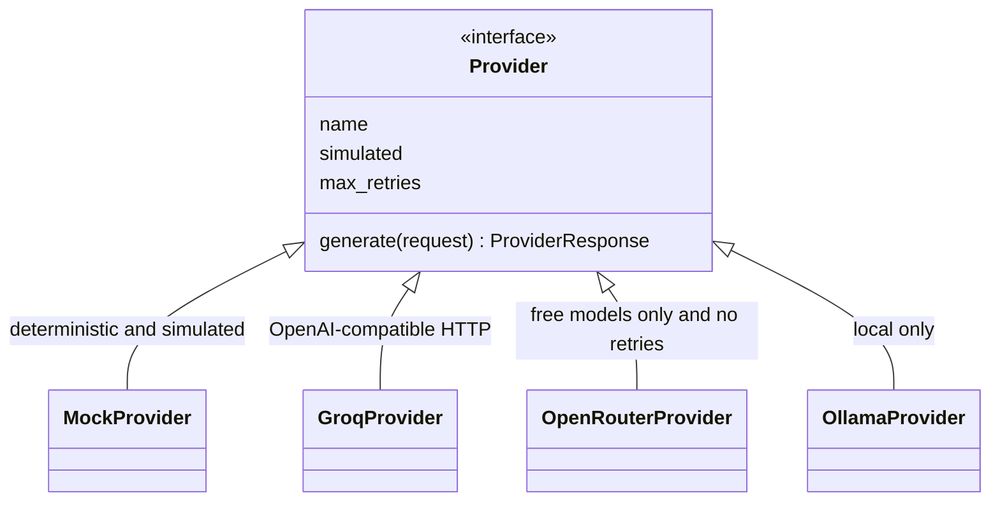
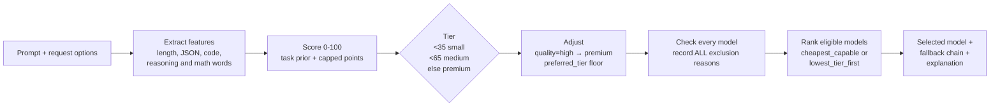
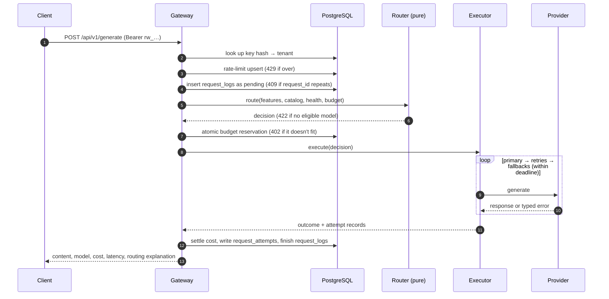
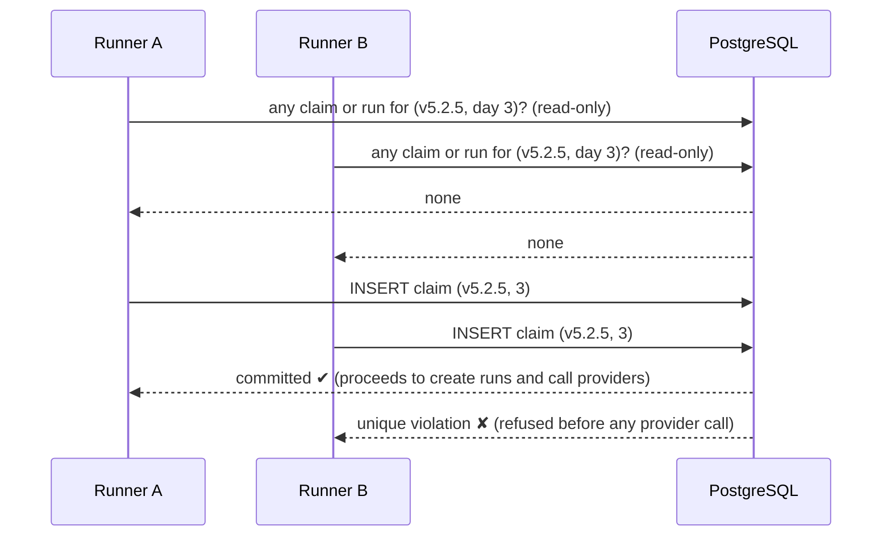
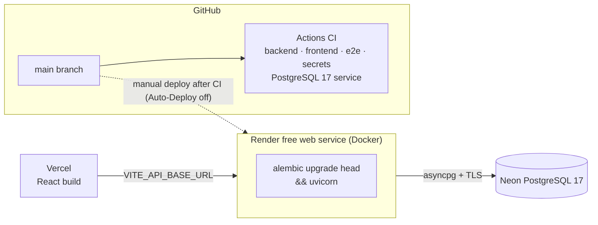

# Project overview: how RouteWise AI works

This is a guided tour of the design, written so you can explain each part in an interview. Every statement here
matches the code. File paths are given so you can show the implementation. For the request/response contract see
[API.md](API.md); for exact routing weights see [ROUTING_METHODOLOGY.md](ROUTING_METHODOLOGY.md).

> **Production is mock-only.** The deployed API has only the mock provider enabled, so its responses are simulated.
> Real Groq calls were made only by the benchmark CLI (see [Evaluation framework](#evaluation-framework)).

## Contents

1. [Big picture](#1-big-picture)
2. [Backend architecture](#2-backend-architecture)
3. [Frontend architecture](#3-frontend-architecture)
4. [Database architecture](#4-database-architecture)
5. [Model-provider abstraction](#5-model-provider-abstraction)
6. [Intelligent routing](#6-intelligent-routing)
7. [Request lifecycle](#7-request-lifecycle)
8. [Error handling and reliability](#error-handling-and-reliability)
9. [Evaluation framework](#evaluation-framework)
10. [Atomic benchmark execution claims](#10-atomic-benchmark-execution-claims)
11. [Deployment architecture](#11-deployment-architecture)
12. [Design decisions and trade-offs](#12-design-decisions-and-trade-offs)

## 1. Big picture

RouteWise is a **gateway**: a service that sits between applications and LLM providers. An application sends one
kind of request to one endpoint. The gateway decides which model should answer, calls it safely, and records what
happened and what it cost.

**Interview line:** "Applications talk to one API. Inside, a pure routing function decides the model, an executor
handles retries and fallbacks, and every decision and cost is stored in PostgreSQL."

## 2. Backend architecture

FastAPI application in [`backend/app/`](../backend/app/), created by `app.main:create_app`. It is async throughout:
the gateway mostly waits on provider HTTP calls, so async lets one process serve many requests at once.

| Package | Role | Key idea |
|---|---|---|
| `api/v1/` | HTTP routes: `generate`, `catalog`, `health`, `tenant` (`/me`), `admin` | **No business logic**: handlers validate input and delegate |
| `services/factory.py` | `build_gateway()` wires router, executor, providers and database | The API and the benchmark use the **same** builder, so the benchmark tests the real pipeline |
| `services/gateway.py` | Orchestrates one request: auth result → rate limit → route → reserve → execute → settle → persist | The only place that writes `request_logs` |
| `services/executor.py` | Calls providers with retries, backoff, fallbacks and a deadline | Only models already approved by the router are called |
| `routing/` | `features.py` (prompt features), `engine.py` (score, tier, filter, rank), `config.py` (policy schema) | **Pure and deterministic**: no I/O, same input → same decision |
| `providers/` | `base.py` interface; `groq`, `openrouter`, `ollama`, `mock` adapters; `catalog.py` model registry | Adding a provider means implementing one interface |
| `resilience/health.py` | Circuit breakers, cooldowns, provider lockout, observed latency | In memory, per process |
| `accounting/` | `cost.py` (actual vs estimated cost), `budget.py` (atomic reservations), `usage.py` (aggregates) | Unknown cost is `None`, never 0 |
| `auth/` | API-key hashing, lifecycle and lookup; admin sessions and login throttle | Keys stored only as HMAC-SHA256 |
| `tenancy/rate_limit.py` | Per-tenant fixed-window rate limiting | One atomic upsert per request |
| `evaluation/` | Dataset loading, scorers, statistics, runner, reports, quota pacing | Drives the gateway in-process |
| `core/` | Settings (`config.py`), JSON logging with redaction, the error envelope | Every error has the same shape: `{"error": {code, message, request_id, details}}` |
| `db/` | Async engine and session, ORM models, Alembic helper | Neon URL normalisation for asyncpg |

**Interview line:** "I kept routing as a pure function and the HTTP layer thin. Business logic lives in a service
layer that the API and the benchmark share, so what I benchmarked is exactly what serves traffic."

## 3. Frontend architecture

A React 19 + TypeScript single-page app in [`frontend/src/`](../frontend/src/), built with Vite, styled with
Tailwind and charted with Recharts.

- **Routing:** `App.tsx` defines 8 routes. Pages are lazy-loaded, so the chart library downloads only for pages
  that draw charts.
- **Data access:** one typed client, `api/client.ts`, with types in `api/types.ts`, plus a `useApi` hook. Every
  page handles loading, empty and error states.
- **Auth:** `components/Auth.tsx`. The admin types `ADMIN_TOKEN` once and the app exchanges it for a short-lived
  session token through `POST /admin/session`; the token itself is never stored. Only *Providers & Models* works
  without signing in.
- **Honesty in the UI:**
  - `DemoBanner.tsx` shows *DEMO — simulated responses* whenever `/health` reports `simulated_only: true`.
  - Mock rows carry a *simulated* badge.
  - Unknown charges are shown as unknown, never as $0.
- **Configuration:** only `VITE_API_BASE_URL`, which is public. No secret is ever put in a `VITE_*` variable.
- **Tests:** Vitest component tests (28) and Playwright end-to-end tests (desktop and mobile) that start their own
  throwaway backend.

## 4. Database architecture

PostgreSQL (Neon in production, SQLite for fast local tests). Schema managed by Alembic; head **`0003`**. Full
column reference: [DATABASE_SCHEMA.md](DATABASE_SCHEMA.md).

| Design choice | Why |
|---|---|
| `request_logs` + `request_attempts` | One row per client request, plus one per provider call (retries and fallbacks), so you can see exactly what was tried |
| Decision stored as JSON (`request_logs.decision`) | The full routing explanation is kept for audit and for the dashboard |
| `prompt_sha256` instead of prompt text | Privacy: a fingerprint of the prompt is kept without storing its content, so identical prompts can be recognised. It isn't tamper-proof evidence: the hash sits in the same database rows, unsigned, so anyone who can change a row can change its hash |
| One model, many `pricing_snapshots` | Each model has a price history: snapshots are matched to a model by `(provider, model_id)` (unique per `effective_date`; a logical link, not a foreign key). `provider_models.pricing_snapshot_id` is a nullable foreign key to the current one |
| `tenant_budgets` with `limit`, `spent`, `reserved` | Lets the gateway hold money *before* calling a provider, then settle the actual amount afterwards |
| `pricing_snapshots` append-only | A price change is a new row with its source and date, so old costs stay explainable |
| Unique `(tenant_id, client_request_id)` | Idempotency: the same request ID can't be processed twice |
| Unique `(revision, schedule_day)` on `benchmark_execution_claims` | The database itself guarantees that a benchmark day starts at most once |
| Strings + CHECK constraints instead of native enums | Adding a status still needs an Alembic migration that drops and recreates the CHECK constraint (and updates the model), but that is simpler than altering a native PostgreSQL enum type |

## 5. Model-provider abstraction

Every provider implements the same small interface ([`providers/base.py`](../backend/app/providers/base.py)): send
a normalised request, get back a normalised response (content, tokens, latency, provider-reported model) or a
typed error.

- **Errors are classified once**, so the executor can decide what to do: `retryable` (timeout, 5xx, network: try
  the same model again) and `fallback_eligible` (rate limit, auth, missing model: try the next model). A bad
  request is neither: stop, because another model would fail the same way.
- **Shared HTTP code** (`providers/http.py`) handles the OpenAI-compatible format, refuses redirects and never
  echoes credentials into errors.
- **Model registry** ([`config/models.yaml`](../backend/config/models.yaml)): each model has a tier, billing
  class, context window, capabilities and a list price with a source URL. Enabled paid models are rejected at
  load time.
- **Mock provider:** deterministic and always marked `simulated`. Production uses it; so do all automated tests.
- **Verification status:**
  - Groq: real calls succeeded in the benchmark.
  - OpenRouter and Ollama: tested only with fake HTTP transports.

## 6. Intelligent routing

"Intelligent" here means **explainable rules**, not an AI model.

1. **Features**: estimated input tokens (~4 characters per token), requested output length, JSON output, and
   counts of multi-step markers, constraint words, reasoning verbs, math terms and code fences.
2. **Score**: a task-type prior (classification 5, extraction 15, chat 15, qa 20, summarization 25, creative 30,
   code 45, reasoning 50), plus capped feature points, clipped to 100.
3. **Tier**: below 35 small, below 65 medium, else premium. `quality=high` forces premium; `preferred_tier`
   raises the floor (and lowers it only with `allow_downgrade=true`).
4. **Filter**: every model is evaluated and every reason it is excluded is recorded, for example
   `TIER_TOO_LOW`, `CAPABILITY_MISSING`, `CIRCUIT_OPEN`, `BUDGET_CONSTRAINT`, `PAID_MODEL_BLOCKED`.
5. **Rank**:
   - `cheapest_capable` sorts by worst-case list cost, so a higher-tier model can win if it's cheaper
     (`TIER_ESCALATED`).
   - `lowest_tier_first` prefers the required tier.
   - OpenRouter always ranks last, because its free allowance is small.
6. **Explain**: the response's `routing` object and `request_logs.decision` hold the score contributions, tiers,
   reason codes, excluded models and fallback chain.

**Worked example (current Groq catalog):**
1. A short classification prompt scores about 5, which needs the small tier, so `gpt-oss-20b` is chosen
   (`LOW_COMPLEXITY`, `CHEAPEST_ELIGIBLE`).
2. A multi-step reasoning prompt scores above 65, which needs premium, so `gpt-oss-120b` is chosen.
3. Groq has no medium model, so medium requests escalate to `gpt-oss-120b`.

**Why rules instead of an LLM router:** zero added latency and cost, deterministic and testable, and every point of
the score can be explained. The weakness is honest: keywords miss semantic difficulty and can be gamed.

## 7. Request lifecycle

## Error handling and reliability

| Mechanism | What it does | Default |
|---|---|---|
| Provider timeout | Each attempt is cut off | 30 s (`PROVIDER_TIMEOUT_S`) |
| Request deadline | Caps the whole request, including fallbacks | 60 s (`REQUEST_DEADLINE_S`) |
| Retries | Same model, transient errors only, exponential backoff with full jitter; `Retry-After` honoured if it fits | 1 retry (OpenRouter 0); backoff 0.5–4 s |
| Rate limits | Never retried on the same model; move to the next model | — |
| Fallback chain | The router's ranked eligible list, so fallbacks obey the same tier, budget and paid-model rules | — |
| Circuit breaker | Opens after repeated failures; the model is skipped until a cooldown passes, then tested again (half-open) | 3 failures, 30 s |
| Provider lockout | Auth failure or exhausted quota disables a provider's models | — |
| Budget safety | Atomic reservation; unknown usage counts at worst case; abandoned reservations are charged in full by `app.cli reconcile` | stale after 600 s |
| One error format | `{"error": {code, message, request_id, details}}`; validation errors never echo input | — |
| Readiness | `/ready` returns 503 unless the database is reachable **and** its Alembic version equals the code's head | — |

**Atomic budget reservation**
([`accounting/budget.py`](../backend/app/accounting/budget.py)). A reservation is one conditional `UPDATE … SET
reserved = reserved + :amount WHERE spent + reserved + :amount <= limit`. PostgreSQL locks the row and re-checks
the condition, so 25 concurrent requests against a budget that fits 10 reserve **exactly 10**. That is tested on
real PostgreSQL in CI.

**Benchmark database reliability** (added after a real Neon timeout interrupted Day 2):
- Every benchmark database step is retried with bounded backoff (1, 2, 4, 8, 16 s).
- Result writes are idempotent.
- A combination is retried only if the quota ledger proves no provider request was sent.
- Runs are never marked complete unless every result is verified in the database.

## Evaluation framework

The benchmark asks: *does routing keep quality while lowering cost, compared with always using the premium model?*

- **Dataset:** 45 cases (15 simple, 18 standard, 12 complex) in
  [`evaluation/datasets/routewise_bench_v5.jsonl`](../evaluation/datasets/routewise_bench_v5.jsonl).
  - Each case has a deterministic scorer: exact match, numeric, JSON, regex, contains or validator.
  - Scorers are validated against reference and adversarial answers.
- **Strategies:**
  - `baseline_premium`: every request at the premium tier
  - `routewise`: `cheapest_capable`
  - `routewise_tier_first`: `lowest_tier_first`
- **Pre-registration:** thresholds are written down and hashed *before* running.
  - Quality: non-inferior if within 5 percentage points of the baseline, "supported" only if the bootstrap CI's
    lower bound is above −0.05.
  - Cost: lower cost per accepted answer claimed only with CI-supported quality.
- **Reproducibility:** an experiment manifest pins SHA-256 hashes of the code, configuration, dataset and
  pacing. If the code changes, the old registration refuses to run.
- **Statistics:** Wilson 95% CIs per strategy; paired bootstrap (10,000 resamples, fixed seed) for differences.
- **Quota safety:** before each provider attempt the runner reserves the worst-case tokens in a persistent ledger.
  A preflight refuses to start if the day's worst case doesn't fit the operator's same-day quota reading.
- **Real calls:** the CLI (`app.cli eval-run`) builds the same gateway in-process with Groq enabled for that
  process only. The deployed API never calls Groq.

Results and their limits: [BENCHMARK_RESULTS.md](BENCHMARK_RESULTS.md).

## 10. Atomic benchmark execution claims

**Problem:** a benchmark day must run **exactly once**. Re-running a failed day, or starting it twice at the
same moment, would bias results and waste quota.

**Solution** (v5.2.5, migration `0003`): the table `benchmark_execution_claims` has a **unique constraint on
`(revision, schedule_day)`**.

- The read-only check also catches runs created before claims existed.
- The **insert** is the real guarantee: the database lets exactly one claimant win.
  - The repository's tests (SQLite and PostgreSQL in CI) race 4 claims and 3 runner starts; exactly one succeeds.
  - A one-off stress check before the production migration raced 20 claimants on a disposable PostgreSQL 17: 1
    won, 19 were refused.
- **Fail closed:** if the database is unreachable, the table is missing, or a commit's acknowledgement is lost,
  the run is refused. A lost acknowledgement means the retry hits the constraint, so the day counts as claimed
  but nothing runs.
- Claims are never deleted, so a failed day can't be restarted.

## 11. Deployment architecture

- **Container start:** the Dockerfile's `CMD` runs `alembic upgrade head` and only then starts uvicorn, so the
  schema and code move together. Render has no separate pre-deploy step.
- **Health:**
  - Render checks `/api/v1/health`, which shows the process is up.
  - `/api/v1/ready` adds the database and migration-version check.
- **Production settings:**
  - `APP_ENV=production`, `MOCK_PROVIDER_ENABLED=true`, `GROQ_ENABLED=false`
  - secrets set only in Render's dashboard
  - weak secrets and SQLite refused at startup
- **Rollback rule since `0003`:** an image without the `0003` migration file can't start against the migrated
  database (Alembic "can't locate revision"). The prepared rollback target is commit `4193a94`: the previous code
  plus only that migration file. Full procedure: [DEPLOYMENT.md](DEPLOYMENT.md).
- **Free-tier behaviour:** the instance sleeps after 15 idle minutes; the first request takes about a minute.

## 12. Design decisions and trade-offs

| Decision | Benefit | Cost |
|---|---|---|
| Rule-based router | Deterministic, explainable, zero latency and cost | Misses semantic difficulty; keyword-gameable |
| Async FastAPI + SQLAlchemy | Many concurrent requests waiting on I/O in one process | Async complexity; asyncpg needs URL translation for Neon |
| Shared pipeline for API and benchmark | The benchmark measures the real system | The benchmark needs a database and the full app |
| Shadow budgets on list price | Meaningful cost control even on free tiers | Not real money; can over-count unknown usage (on purpose) |
| Reject duplicate `request_id` (409) | No stored responses needed (privacy) | Clients don't get the original response replayed |
| In-memory health state | No extra infrastructure on a free host | Lost on restart; not shared across instances |
| Fixed-window rate limit | One atomic SQL statement | Allows bursts up to 2× across a window boundary |
| No response cache | Simpler, no stale or cross-tenant leakage risk | Repeated prompts cost the same each time |
| Mock-only production | Public demo can't burn the benchmark's free quota | Live responses are simulated |
| Pre-registered, hash-pinned benchmark | Results can't be quietly tuned after the fact | Heavy process; any code change needs a new registration |
